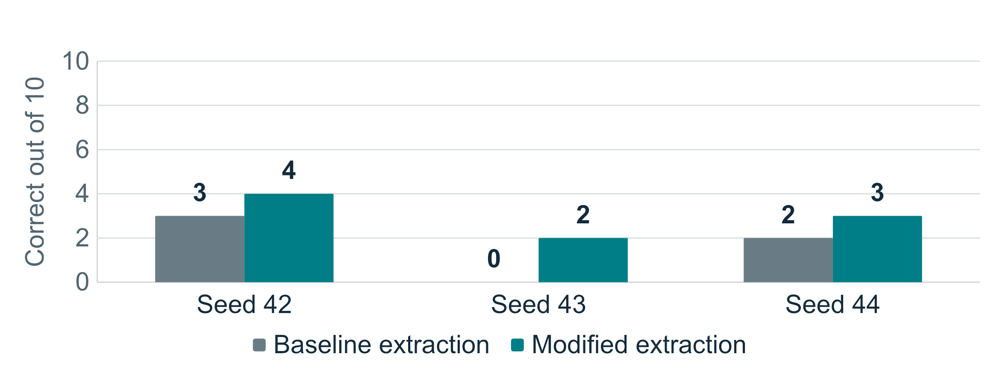

# Partial Reproduction of LiTS Math Search

FTEC5660 reproducibility work by GitHub account `fancecy`.

The objective is a **partial reproduction of the LiTS math search workflow,
followed by a controlled modification of answer extraction rules**. The reported
capability being tested is the authors' documented MCTS math reasoning pipeline.
The local setup uses their code with a free model on 10 fixed questions at
3 repeated seeds. Both scoring conditions share the same saved generations.
The extraction failure is an observation from our local study, not a result
reported by the original paper. The paper's 37% accuracy is a contextual reference
under different settings. This study does not establish that benchmark result
or improved model reasoning.

## Measured results

| Seed | Baseline correct | Modified correct | Paired difference |
| --- | --- | --- | --- |
| 42 | 3 / 10 | 4 / 10 | +10.0 pp |
| 43 | 0 / 10 | 2 / 10 | +20.0 pp |
| 44 | 2 / 10 | 3 / 10 | +10.0 pp |

Across seeds, baseline extracted-answer accuracy is
**16.7%** (sample SD 15.3 percentage points),
and modified extracted-answer accuracy is **30.0%**
(sample SD 10.0 percentage points).
The paired mean difference is **+13.3 percentage points**.
There are 30 task executions over 10 unique questions, not 30 independent questions.



The same raw outputs support both conditions. Modified scoring requires zero
additional generation calls. The package records 6 changed predictions
and includes a review of every one in
[`manual_audit.json`](experiments/results/main/manual_audit.json).

The development pilot also appears as question 0 in the formal subset.
Excluding that question leaves 27 task executions over 9 questions:
5 baseline correct and
7 modified correct. This is a descriptive
sensitivity check, not a separate held-out benchmark.

## Submission materials

- [English report PDF](submission/LiTS_Reproducibility_Report.pdf)
- [Editable report](submission/LiTS_Reproducibility_Report.docx)
- [Editable CUHK-style English PowerPoint](submission/LiTS_Reproducibility_CUHK_Editable.pptx)
- [English presentation script](submission/English_Presentation_Script.txt)
- [Presentation questions and answers](submission/English_Presentation_QA.txt)
- [Completed measurements](experiments/results/main/study_status.json)
- [Per-question results](experiments/results/main/per_question_results.csv)
- [Recomputed report statistics](experiments/results/main/report_statistics.json)
- [Changed-prediction audit](experiments/results/main/manual_audit.json)
- [Downloadable submission files](https://github.com/fancecy/FTEC5660-LiTS-Reproducibility/releases/tag/v1.3)

The PowerPoint uses CUHK purple and gold styling with the official website logo. Text, tables and the results chart remain editable. It contains internal navigation and public source links. Its notes
contain an English talk designed for roughly 10 to 12 minutes. The course also
requires a personal Zoom recording of at most 15 minutes. The slides and script
support that recording; they do not replace its submitted recording link.

## Fixed setup and limits

- Source: `xinzhel/lits-llm` at `25e94d862cb4514c22d9a80a635e392461769df7`.
- Model: `Qwen/Qwen2.5-1.5B-Instruct`, pinned revision
  `989aa7980e4cf806f80c7fef2b1adb7bc71aa306`.
- Data: `xinzhel/math500-float`, pinned revision
  `d27dc61b1123c2fdc4eea855c802be87dfa9d536`.
- Subset: first 10 of 316 numerical rows in source order, with identifiers saved
  before the formal run. Solutions do not enter generation prompts.
- Host: M4 MacBook Air with 16 GB memory. The execution environment lacked Metal
  access, so generation used CPU with four Torch threads.
- Search: MCTS, two iterations, two actions, maximum depth two, rollout one.
- No paid model API was used. Total shared generation involved
  392 logged LLM calls and 20,357 output tokens.

The local model, reduced search settings and terminal-selection adapter differ
from the paper. The current upstream CLI uses native-tool LLM voting. This study
uses deterministic plurality in both conditions and the author's numeric
correctness checker. The extraction-helper baseline is therefore not the full
paper evaluator. These model and evaluator changes limit direct paper comparison.
Two selected geometry questions contain serialized diagram code rather than
rendered images, which is also an input-representation limitation.

## Run the experiment

The tested platform is macOS with Python 3.13. Start from this repository root.

```bash
python3.13 -m venv .venv
source .venv/bin/activate
python -m pip install -e . -c experiments/environment.lock.txt
python experiments/bootstrap_model.py
python experiments/test_local_study.py
python experiments/run_study.py --limit 10 --seeds 42 43 44 --name reproduction
python experiments/finalize_study.py experiments/results/reproduction
```

On macOS, if Python's certificate bundle is not configured, set
`PIP_CERT=/etc/ssl/cert.pem` for installation. Verification remains enabled.
Model download is about 3 GB. CPU generation can take hours. Local caches and
model weights are excluded from Git. Use a new study name to avoid mixing runs.

To inspect the submitted result without generating again:

```bash
python experiments/summarize_study.py experiments/results/main
python experiments/analyze_results.py experiments/results/main
```

## What changed

The compatibility patch prevents a model-loading `device` setting from leaking
into the MCTS search constructor. Both scoring conditions share that fix.
The measured modification is
[`answer_format.py`](experiments/answer_format.py): it preserves baseline
extractions and recognizes conservative additional answer forms without
accessing references or calling a model. Tests include the observed pilot
failure and negative examples with competing numbers.

Generation and scoring commits, the dataset hash and extractor hash appear in
the saved study status. Raw trees, terminal text and per-call usage allow
independent checks. Empty outputs remain in the planned denominator. The report
distinguishes parsing failures from mathematical answer errors and does not
silently change primary scores after manual review.

## Sources

- [LiTS paper version 2](https://arxiv.org/html/2603.00631v2)
- [Pinned upstream source](https://github.com/xinzhel/lits-llm/tree/25e94d862cb4514c22d9a80a635e392461769df7)
- [Detailed protocol and debug diary](experiments/README.md)
- [Original upstream README](UPSTREAM_README.md)

This course fork disables the upstream PyPI publishing workflow. The upstream code and dataset retain their Apache 2.0 terms. AI tools assisted
setup, coding and drafting. Recorded executions and the case audit support the
measurements reported here.
